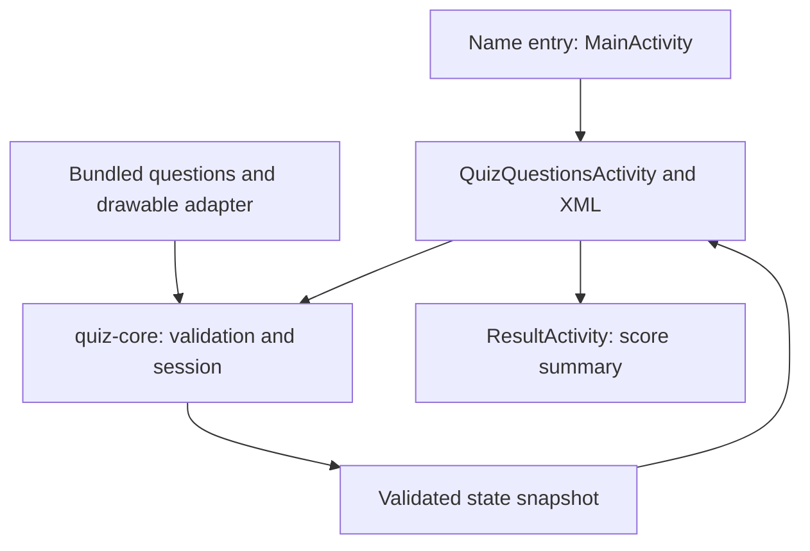

# MyGameQuizApp

An offline Android quiz app, modernized incrementally from the original Kotlin/XML project.
The original name-entry → quiz → result flow and package ID remain intact.

## Current milestone

- Seven distinct bundled geography questions with four choices and one correct answer.
- Android-independent Kotlin session engine and question validation.
- A question must be answered before advancing; submitted answers cannot earn points twice.
- One point per correct answer, actual question totals and a completion summary.
- Validated Activity-instance snapshots for position, selected answer and recorded answers.
- View Binding in the existing screens and textual answer feedback in addition to colors.
- Original XML flag/trophy/background graphics replacing unverified raster assets.

This is a first modernization slice, not a finished release. Timers, multi-answer questions,
JSON import, categories/difficulty selection, Room history, achievements and coherent dark
mode are **not implemented**. See the [40–64 hour roadmap](ROADMAP.md).

## Audit before implementation

The original app placed scoring/navigation state directly in an Activity, repeated the same
Brazil question seven times, used duplicate IDs and showed progress out of 10. Its example
tests did not cover quiz behavior. It used Kotlin 1.6.0, AGP 7.0.3 and Gradle 7.0.2.

The prioritized [repository audit](docs/audit.md) explains bugs, architecture, dependencies,
privacy and asset provenance. The first milestone preserves XML instead of introducing a
Compose rewrite or an unused database/DI framework.

## Architecture



`quiz-core` is pure Kotlin/JVM. The `app` module owns Android resources and navigation.
A ViewModel/StateFlow migration and data repository come later when asynchronous imports,
timers and persistence require them. Read the [architecture notes](docs/architecture.md).

## Build and run

Prerequisites: JDK **17**, Android SDK platform **35**, build tools **34.0.0** and network
access for first-time Gradle/Maven downloads. Install SDK packages and review/accept their
licenses through Android Studio or your SDK tools. No Android SDK is bundled here.

```bash
git clone https://github.com/Davorin51/MyGameQuizApp.git
cd MyGameQuizApp
# Check out the modernization branch if it has not yet been merged:
git switch modernization/quiz-foundation
./gradlew :app:assembleDebug
```

On Windows use `gradlew.bat`. Open the existing project directory in Android Studio, choose
JDK 17 for Gradle, synchronize and run the `app` configuration. Use an ignored `local.properties`
with `sdk.dir=/your/android/sdk` or set `ANDROID_HOME` for the local SDK.

The debug APK is generated at `app/build/outputs/apk/debug/app-debug.apk`. Build output is
not committed. Compile SDK is 35; **target SDK remains 31** and min SDK remains 21 until a
separate platform migration is validated. This is not a store-release compatibility claim.

Pinned build baseline: Gradle 8.9, AGP 8.7.3, Kotlin 2.1.21. Existing UI dependency versions
are retained for a focused first change; JCenter and the duplicate Material declaration are
removed, and JUnit is pinned to 4.13.2. Full transitive dependency locking/verification remains
in the roadmap; the Gradle distribution download is SHA-256 checked.

## Verified build

The [first successful Android CI run](https://github.com/Davorin51/MyGameQuizApp/actions/runs/39132119463)
executed the Kotlin/JVM and bundled-pack unit tests, Kotlin formatting, Android lint and
**debug APK assembly**. Download the `debug-apk` and `verification-reports` artifacts from
that run while available. This is build/test evidence, not an emulator or real-device run.

## Tests and quality

```bash
./gradlew :quiz-core:test                 # no emulator; JVM quiz/scoring/validation tests
./gradlew :app:testDebugUnitTest           # checks the actual bundled Android question adapter
./gradlew spotlessCheck                   # pinned ktlint formatting
./gradlew spotlessApply                   # apply Kotlin formatting; inspect changes
./gradlew :app:lintDebug :app:assembleDebug
./gradlew :app:connectedDebugAndroidTest   # requires a connected device/emulator
```

Core tests run on the JVM; the root project still resolves its build plugins during
configuration. The app unit test/build/lint need an installed Android SDK, but no emulator.
The inherited instrumentation test only verifies the package name; a real UI regression suite
is future work and is not represented as complete.

CI runs JVM/app unit tests, Android lint, Kotlin formatting and debug APK assembly on JDK 17.
Reports and the built debug APK are uploaded as workflow artifacts when those steps succeed.
See [actual verification status](docs/verification.md) before relying on any build claim.

## Screenshots

No new application screenshots are included yet. The app must be installed and exercised on
an emulator/device before real screenshots can be captured; mockups are not presented as
running-app evidence. That verification is tracked in the roadmap.

## Privacy and licensing

No accounts, trackers, ads or network clients are added. The player display name is
used for the quiz/result flow and Android instance state; it is not sent to a server.
Persistent progress/history is not implemented. Existing Android backup behavior needs review
when durable progress is introduced.

A project-wide license is **pending ownership verification**. No MIT license is inferred from
GitHub account ownership. The old raster artwork was removed because no usable license record
was present; its background showed a watermark. New XML artwork and question text are original
to this change. See [the audit](docs/audit.md), [contribution guide](CONTRIBUTING.md) and
[changelog](CHANGELOG.md).
