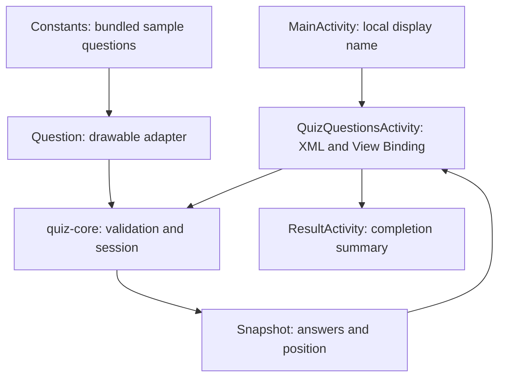

# Architecture: incremental domain extraction

`quiz-core` imports no Android APIs. It validates nonempty packs, positive unique IDs, prompts,
option count/content, duplicate options/content and valid one-based correct-answer positions.
The app adapter retains the existing drawable-bearing `Question` type and supplies its domain
form to `QuizSession`; drawables do not leak into domain calculations.

A session transitions through selecting → submitted → next question → completed. Submit with
no selection leaves position and score unchanged. Once submitted, selection is locked and
repeat submission returns `ALREADY_ANSWERED`. Only `advance` moves position, and only after
submission. Score is derived from recorded answers, one point per correct answer, bounded by
the question count. `correctPercentage` divides correct answers by the complete pack size,
not just answered questions; it is meaningful as a final quiz percentage at completion.

The Activity stores a small Bundle snapshot on instance save. Restore validates positions,
answer ranges, completion and selection consistency, and derives score instead of trusting a
saved score field. Invalid snapshots restart the sample session. This is lifecycle restoration,
not durable quiz history. Pack-version migration and database persistence remain future work.

There is no timer, multi-answer partial-credit policy, JSON parser, Room entity, repository
layer or network client in this milestone. Avoiding empty interfaces keeps current ownership
clear. Later data-source/repository boundaries will feed the same domain module.
